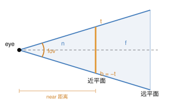

## 作业一相关知识

计图作业一-相关知识点：
1. 齐次坐标1：
	https://akuan.blog.csdn.net/article/details/124138915
2. 齐次坐标2： 
	https://blog.csdn.net/hangl_ciom/article/details/104441075
3. 视图矩阵推导过程（task 1）：
	https://blog.csdn.net/qjh5606/article/details/88752789
4. 透视&正交投影矩阵（强推，task 2, 3）：
	https://www.songho.ca/opengl/gl_projectionmatrix.html
5. 四元数与三维旋转，旋转公式及旋转差值部分（task e）：
	https://krasjet.github.io/quaternion/quaternion.pdf
6. 光栅化（了解含义即可）：
	https://chuquan.me/2024/03/30/foundation-of-computer-graphic-04/
关键词与提示：
7. 三角形边函数法（task 4）[(99+ 封私信) 计算几何：详解如何判断一个点是否在三角形内 - 知乎](https://zhuanlan.zhihu.com/p/1920874476427523568) 
8. 重心坐标（task c, d）
9. 解几/高代坐标变换（几乎全部）
⬆️来自一个心善学长

### 齐次坐标
欧几里得空间里平行线不能相交，但是射影空间里可以（无穷远处）。
解决方案：齐次坐标。

同时从坐标变换的角度来看也有利于统一、简化运算。（都可以表示成矩阵乘法，大善）
齐次坐标变换矩阵：

齐次坐标和普通代数分量表达的相互转换：

### 视图矩阵推导
（首先啥是视图矩阵啊）
视变化，是将世界坐标系下的坐标变化到摄像机坐标系，通过乘以视图矩阵实现。（所以本质上就是坐标变换，让相机在新坐标系中位于原点）

（新的问题是：那固定一个点作为观察点不也有挺多种变换方式的吗……角度怎么转？）
好了解答貌似立马就端上来了，view矩阵可以由两个矩阵合成：
- 将摄像机平移至原点的矩阵T
- 将坐标点从世界坐标系转换至摄像机坐标系的矩阵R

 $$eye,\quad target,\quad up_0 $$
  分别代表相机位置、观察目标的位置、初始上方向参考向量。
  1. 求forward: 相机看向哪里
	从eye指向target的向量
	
	OpenGL约定相机朝-Z方向看，所以相机坐标系的正Z轴其实是-f
2. 求side：相机的右方向
$$ \boxed{ s=\frac{f\times up_0}{\|f\times up_0\|} } $$

因为叉积结果同时垂直于两个输入向量，所以 s 与相机的视线垂直。 
这里叉积的顺序不能随意交换：$f\times up_0=-(up_0\times f)$, 交换顺序得到的就是相反方向。
3. 求真正的相机up
	初始提供的 $up_0$ 只是一个参考上方向，不一定垂直于 $f$。因此还需要构造一个与 f,s 都垂直的向量：
$$ u= s \times f $$

$$ view = M^{-1} $$
平移矩阵：

旋转矩阵：

这里我觉得很有insight的一点是，旋转其实可以理解为基变换。

所求矩阵view的计算：

（R-旋转矩阵-正交矩阵）

### 透视&正交投影矩阵
投影矩阵干了两件事：裁剪clipping(即frustum culling，视景体剔除)和生成NDC（normalized device coordinates，**即坐标范围在-1到1之间**)。

一般常用的有透视投影和正交投影，相应地也就有两种投影矩阵。

#### 透视投影

（总示意图）

（选取近裁剪面当做投影平面，俯视图）

（same，侧视图）

注意  和  都依赖  并与  成反比。这是**构建投影矩阵的第一个线索**。在eye coordinates被投影矩阵乘后，得到的裁剪坐标仍然是[齐次坐标](https://zhuanlan.zhihu.com/p/73123357)([homogeneous coordinates](https://link.zhihu.com/?target=http%3A//www.songho.ca/math/homogeneous/homogeneous.html))。最终它需要除以裁剪坐标的w分量，才能变成标准化设备坐标(NDC)。

因此，我们可以把裁剪坐标的w分量设置为  ，则投影矩阵第4行变为(0, 0, -1, 0)。（看起来就是一个trick，后面本来就要除以裁剪坐标的w分量，刚好这里$x_p,y_p$都要除以$-z_e$，所以不妨就让$w=-z_e.$ 

接下来，我们把刚计算得到的  线性地(with linear relationship)映射到NDC中的  (这里的n表示NDC)：

可以求出：

接下来，把上面求得的  和  代入刚刚求到的线性关系式得:

注意上面刚刚求得的  是NDC坐标，而NDC应该是由裁剪坐标除以  得到 。又因为，之前我们把  的值设置为  ，所以上面  表达式中括号里的部分表示裁剪空间的坐标  。

加上上面的两个方程，我们可以找到投影矩阵的第1行和第2行:

接下来剩第三行。
在eye space中  总是被投影到近裁剪面(near plane)上，即值总是为-n。但是我们为了完成裁剪(clipping)和深度测试(depth test)，每一个顶点应该具有不同的z值。此外，投影变换应该是可逆的。既然我们知道z不依赖于x和y的值，那么我们就借用w分量来找到  和  之间的关系。因此，我们可以指定第三行长这样：

因为在eye space中，  总是等于1，因此：

为了找到系数A和B，我们把  之间的关系: (-n, -1)和(-f, 1)，代入上面这个等式中，最后得到：

congrats，完整的投影矩阵为：

PS: 由于

这个函数的性质决定了，在离far plane比较近的地方，当  的值差异较小时，它们对应的  值相同。（z-fighting）

PS2：采用对称视椎体的话还可以用fov和aspect来替换l,r,b,t（本质一样）
- fov(Field of View)：表示相机能够看到的角度范围。

- aspect：宽高比（Aspect Ratio）
$$ \boxed{aspect=\frac{width}{height}} $$
then:

$$ \tan\left(\frac{fov}{2}\right)=\frac{t}{n} $$
so: $t=n\tan\left(\frac{fov}{2}\right)$
$aspect=\frac{2r}{2t}=\frac{r}{t}$，因此 $r=aspect*t$

#### 正交投影

在eye space中，所有  分量是线性映射到NDC中的。我们只需要把一个长方体(rectangular volume)所表达的体积缩放成一个立方体(cube)，并把它移动到原点。
（感觉和上面找投影矩阵第二行、第三行差不多）

因为对于正交投影w分量不是必须的，所以正交投影矩阵的第4行为(0, 0, 0, 1)。因此完整的正交投影矩阵为:

### 如何判断一个点是否在三角形内

算法二：利用判断某两个点是否在某条直线的同一侧

算法三：

然后解出u,v并判断

算法四：对算法二的简化。

算法五：
也可以看做对算法二的简化。

呃上面图里的应该打错了，正确的应该是：

### 如何绕法线旋转三角形

参考教程：[OpenGL 3D Rotation About Arbitrary Axis](https://www.songho.ca/opengl/gl_rotate.html?)
首先，计算法线方向很简单。在三角形所在的平面内，我们可以构造两个向量：
$$ \mathbf a=B-A,\qquad \mathbf b=C-A $$

因为叉积得到的向量垂直于两个输入向量，所以：
$$ \mathbf n=\mathbf a\times\mathbf b $$
然后解决如何绕任意三维轴旋转。
——Rodrigues旋转公式

图中，向量 $\mathbf v$ 被分成两部分：

- $\mathbf v_\parallel$：平行于旋转轴的部分，旋转后不变。
- $\mathbf v_\perp$：垂直于旋转轴的部分，绕旋转轴旋转 $\theta$。

设单位旋转轴为 $\hat{\mathbf n}$，则旋转后的向量为：
$$ \boxed{ \mathbf v'= \mathbf v\cos\theta+ (\hat{\mathbf n}\times\mathbf v)\sin\theta+ \hat{\mathbf n}(\hat{\mathbf n}\cdot\mathbf v)(1-\cos\theta) } $$
用矩阵来表达：
$$ R=I\cos\theta +(1-\cos\theta)\hat{\mathbf n}\hat{\mathbf n}^{T} +[\hat{\mathbf n}]_\times\sin\theta $$
其中：
$$ [\hat{\mathbf n}]_\times= \begin{bmatrix} 0&-n_z&n_y\\ n_z&0&-n_x\\ -n_y&n_x&0 \end{bmatrix} $$

这个矩阵叫作叉积矩阵（Skew-symmetric Matrix），满足：
$$[\hat{\mathbf n}]_\times\mathbf v =\hat{\mathbf n}\times\mathbf v $$

### 三角形的重心坐标
参考：[(99+ 封私信) 计算机图形学补充1：重心坐标(barycentric coordinates)详解及其作用 - 知乎](https://zhuanlan.zhihu.com/p/144360079)

如图中黑字就是重心坐标的定义。
另一个重要的等价定义：

PS:如果这个点在某个边的外侧，那么该点与这条边构成的三角形面积计算为负值。
算面积用行列式（或者说叉积）就好了。
最后可以算出：

（求出两个之后第三个可以直接1-另两个）

另一个角度是从坐标系来求解：
以A点为原点，AB,AC分别为新的坐标系的单位向量构建坐标系。
其中给定任意点P的坐标可以用$\beta,\gamma$来表示，即$P(\beta,\gamma)$。不难得出，P点坐标在原坐标系中的位置满足：

这就和上面的定义一样了。
可以将上式表示成一个线性方程组来求解$\beta,\gamma$:

### 四元数相关

（我去抽代怎么还在追）

#### 四元数的数学形式
一个四元数通常写成：$q=w+xi+yj+zk$
或者写成四维向量形式： q=(w,x,y,z) 
其中：
- w 是实部（Scalar Part）。
- (x,y,z)是虚部，也叫向量部分（Vector Part）。
- i,j,k 是四元数的三个虚数单位。
当四元数用于表示三维旋转时，通常要求它是单位四元数：
$$ w^2+x^2+y^2+z^2=1$$
四元数实际上也可以由单位旋转轴和旋转角度构造出来：
$$q= \left( \cos\frac{\theta}{2}, n_x\sin\frac{\theta}{2}, n_y\sin\frac{\theta}{2}, n_z\sin\frac{\theta}{2} \right) $$

这就是轴角表示到四元数表示的转换公式。
btw，q和-q表示同一个三维旋转。
#### 如何用四元数来旋转一个三维向量。
要用四元数 $q$ 旋转一个三维向量 $p$，需要先将它表示成纯虚四元数： $p_q=(0,p_x,p_y,p_z)$
旋转后：$p'_q=q\,p_q\,q^{-1}$
对于单位四元数： $q^{-1}=q^*$,其中 $q^*$ 是共轭四元数。

#### 四元数如何转换成旋转矩阵

将四元数写成：
$$q=(w,\mathbf u),\qquad \mathbf u=(x,y,z) $$

经过展开，可以得到：
$$\mathbf p' = \mathbf p +2w(\mathbf u\times\mathbf p) +2\mathbf u\times(\mathbf u\times\mathbf p) $$
整理成旋转矩阵：

#### 球面线性插值
球面线性插值（Spherical linear interpolation，通常简称Slerp），是四元数的一种线性插值运算，主要用于在两个表示旋转的四元数之间平滑插值。

（左图为线性插值，右图为球面线性插值）
沿着球面大圆弧均匀插值，对应三维物体在两个姿态间以恒定角速度绕固定轴旋转。

设 $q_0,q_1$ 为两个单位四元数。首先计算它们的点积：$d=q_0\cdot q_1$
由单位向量的点积关系: $d=\cos\Omega$
所以：$\Omega=\arccos(d)$

这里 $\Omega$ 表示两个四元数在四维空间中的夹角；采用最短弧表示时，对应的三维相对旋转角度为 $2\Omega$。

SLERP 的公式是：
$$\boxed{ \operatorname{Slerp}(q_0,q_1,t) = \frac{\sin((1-t)\Omega)}{\sin\Omega}q_0+ \frac{\sin(t\Omega)}{\sin\Omega}q_1 } $$

这个公式可以由球面大圆弧上的几何关系推导出来。
